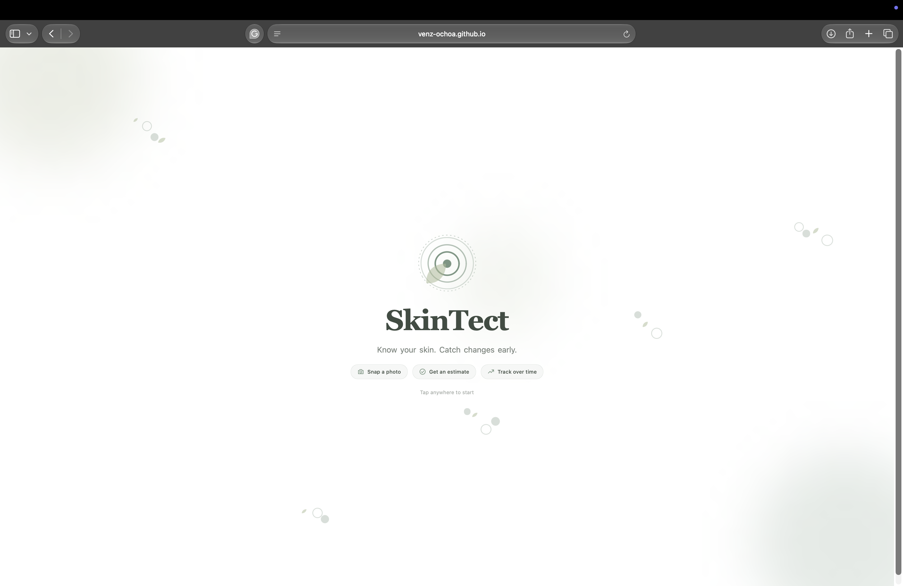
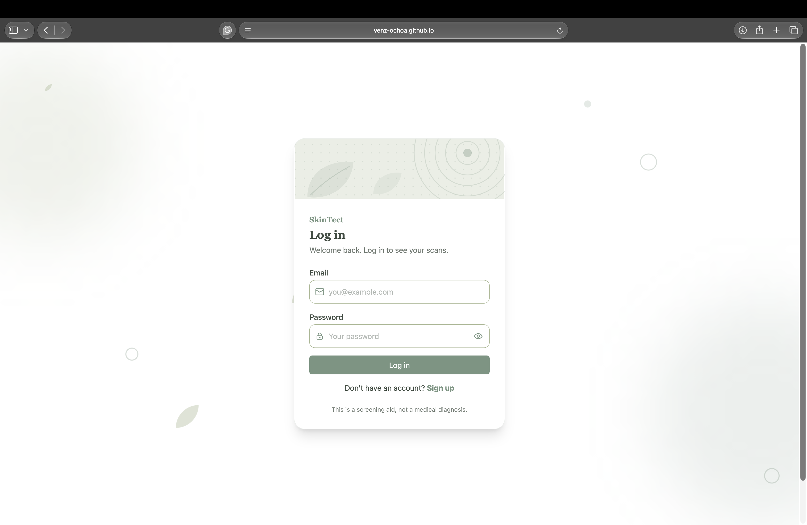
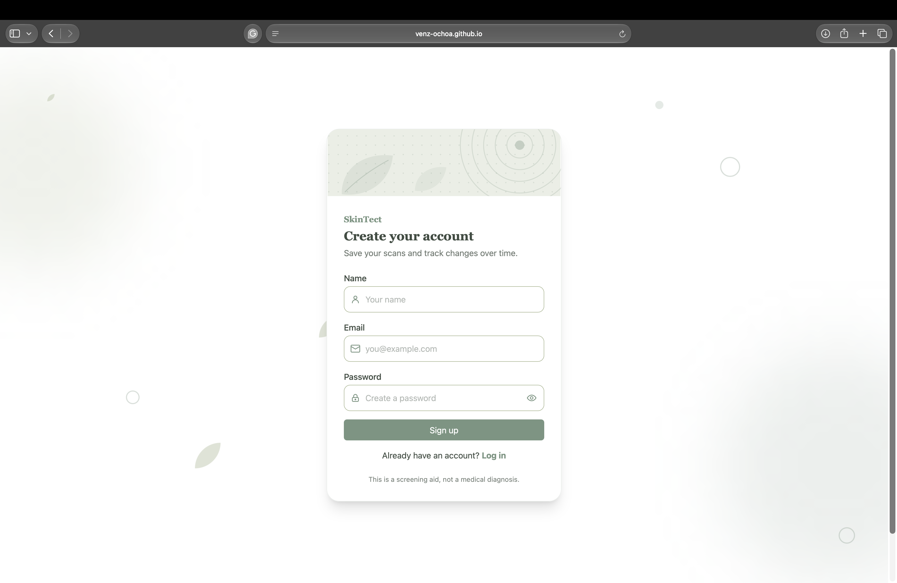
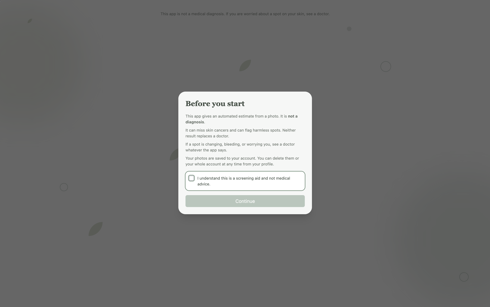
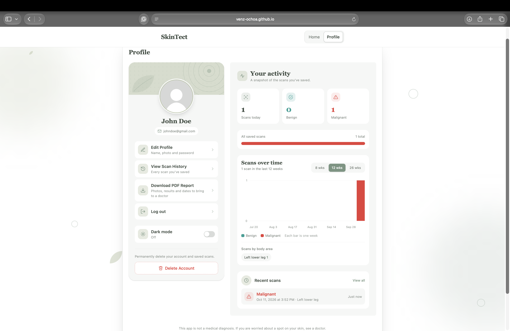

## Mockups

### Start & Authentication

### Home & Scan Flow (Empty & Populated States)

### Scan History

### User Profile & Settings

### Dark Mode

### Mobile View

## Honest Note
Every screen and feature from my initial wireframes and mockups—Login/Sign Up, Home scan upload with heatmap toggle and medical disclaimer, Scan History with detailed views, and Profile management with account deletion—was fully built into the final application. Rather than dropping anything during development, the final build expanded on the original plan by adding a landing splash screen, dedicated desktop and mobile medical disclaimer views, downloadable PDF scan reports, interactive body-location tagging, weekly scan trend charts, and dark mode.